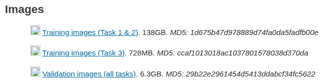

# VAE Training and Inference

Official PyTorch implementation of our paper: [Spectrum Matching: a Unified Perspective for
Superior Diffusability in Latent Diffusion](https://arxiv.org/abs/2603.14645)

**The official SD-VAE codebase [SD-VAE / latent-diffusion code](https://github.com/CompVis/latent-diffusion) is super chaotic if you just want to train the VAE. So that we significantly simplified their code and focus on VAE training and inference.**

We use this repo to finetune official SDVAE on ImageNet 256x256. Of course, you can also use this repo to train multiple VAEs (SD-VAE, EQ-VAE, DSM) from scratch

If you find this repo or our paper helpful, please cite by

```bash
@article{ning2026spectrum,
  title={Spectrum matching: a unified perspective for superior diffusability in latent diffusion},
  author={Ning, Mang and Li, Mingxiao and Zhang, Le and Liu, Lanmiao and Blaschko, Matthew B and Salah, Albert Ali and Ertugrul, Itir Onal},
  journal={arXiv preprint arXiv:2603.14645},
  year={2026}
}
```

## 1. Overview

This repo supports **training and inference for SD-VAE, EQ-VAE, and DSM**, and **inference for VA-VAE**. Training uses a self-contained PyTorch loop with single-GPU and multi-GPU DistributedDataParallel
(DDP) support.


| Model           | Training | Inference | ImageNet 256 configuration                                         |
| --------------- | -------- | --------- | ------------------------------------------------------------------ |
| SD-VAE          | Yes      | Yes       | [SDVAE_config_imgnet256.yaml](configs/SDVAE_config_imgnet256.yaml) |
| EQ-VAE          | Yes      | Yes       | [EQVAE_config_imgnet256.yaml](configs/EQVAE_config_imgnet256.yaml) |
| DSM             | Yes      | Yes       | [DSM_config_imgnet256.yaml](configs/DSM_config_imgnet256.yaml)     |
| VA-VAE (f16d32) | No       | Yes       | [VAVAE_config_imgnet256.yaml](configs/VAVAE_config_imgnet256.yaml) |


## 2. Environment setup

Create the environment from the repository root, since `environment.yaml` installs this project in editable mode:

```bash
conda env create -f environment.yaml
conda activate vae
```

The environment pins Python 3.10, PyTorch 2.8.0, and torchvision 0.23.0 with CUDA 12.8 wheels. The GPU commands below require an NVIDIA driver compatible with these wheels; the eight-process examples require eight visible GPUs.

The checkpoint download helper also requires `wget` and `unzip`.

The LPIPS and PatchGAN components needed from `taming-transformers` are integrated into `losses/` and `models/`. PyTorch Lightning is included to deserialize metadata in the official SD-VAE checkpoint; the training loop itself uses plain PyTorch. LPIPS downloads its weights to `pretrained_models/vgg.pth` on first use, and the pretrained VGG/Inception backbones used by perceptual losses and metrics may also download weights.

## 3. Data Preparation

**ImageNet 256x256**

1. Download the 128,1167 training images and 50,000 val images from [official web](https://www.image-net.org/challenges/LSVRC/2012/2012-downloads.php) 

<p align="left">
  
</p>


2. Create a `train` folder and a `val` folder, unzip the tar files into the folders: 
```bash
mkdir train
mkdir val
tar xvf ILSVRC2012_img_train.tar -C ./train
tar xvf ILSVRC2012_img_val.tar -C ./val
```

3. After unzipping the `train_tar` file, you will get 1000 tar files in `train` folder.
Copy the commands below into a shell file, then run the shell file to further unzip

```bash
dir=./train
for x in $dir/*tar; do
filename=$(basename $x .tar)
mkdir $dir/$filename
tar -xvf $x -C $dir/$filename
done
rm $dir/*.tar
```

The VAE loader scans ImageNet directories recursively, so validation images can remain directly under `val/`. REPA extraction uses `ImageFolder` and requires the class subdirectories under `train/`. **Original ImageNet images do not need to be resized** on disk: training crops and resizes them to 256x256, while validation uses deterministic resizing and center cropping.

Update these entries in the configuration selected for training, keeping the other dataset parameters:

```yaml
data:
  train:
    params:
      train_dir: /path/to/imagenet256/train
      dataset_name: imagenet
  validation:
    params:
      val_dir: /path/to/imagenet256/val
      dataset_name: imagenet
```


**CelebA 256x256**

download the dataset from [kaggle](https://www.kaggle.com/datasets/badasstechie/celebahq-resized-256x256), which will be a single image folder


## 4. Fine-tuning SD-VAE, EQ-VAE, and DSM


**Download the pretrained SD-VAE checkpoint**

All three methods can start from the official [kl-f8 checkpoint](https://ommer-lab.com/files/latent-diffusion/kl-f8.zip). Run the download helper from the repository root:

```bash
bash download_sdvae.sh
```

The checkpoint is extracted to `pretrained_models/model.ckpt`.


we use the following configurations to finetune VAEs:

**SD-VAE**

```bash
OUTPUT_DIR="exps/imagenet256_SDVAE_ft"

torchrun --standalone --nproc_per_node=8 --master_port=29507 \
  stage1_vae_trainer.py \
  --config configs/SDVAE_config_imgnet256.yaml \
  --output_dir "$OUTPUT_DIR" \
  --resume_path pretrained_models/model.ckpt \
  --batch_size 20 \
  --max_train_steps 40001 \
  --eval_interval_steps 2000 \
  --save_top_k 5
```


**EQ-VAE**

```bash
OUTPUT_DIR="exps/imagenet256_EQVAE_ft"

torchrun --standalone --nproc_per_node=8 --master_port=29507 \
  stage1_vae_trainer.py \
  --config configs/EQVAE_config_imgnet256.yaml \
  --output_dir "$OUTPUT_DIR" \
  --resume_path pretrained_models/model.ckpt \
  --batch_size 20 \
  --max_train_steps 40001 \
  --eval_interval_steps 2000 \
  --save_top_k 5
```

**DSM**

```bash
OUTPUT_DIR="exps/imagenet256_DSM_ft"

torchrun --standalone --nproc_per_node=8 --master_port=29507 \
  stage1_vae_trainer.py \
  --config configs/DSM_config_imgnet256.yaml \
  --output_dir "$OUTPUT_DIR" \
  --resume_path pretrained_models/model.ckpt \
  --batch_size 20 \
  --max_train_steps 40001 \
  --eval_interval_steps 2000 \
  --save_top_k 5
```


## Extract REPA latents

After training the VAEs, we use [REPA](https://github.com/forever208/REPA) to train the latent diffusion models.

Before REPA diffusion training, Use [extract_REPA_latents.py](extract_REPA_latents.py) to encode ImageNet
with a trained VAE and write the posterior statistics and images consumed
by REPA. Select the matching configuration and checkpoint from a completed
run; `resolved_config.yaml` records the configuration actually used during
training.

The following example uses a DSM run. Replace `OUTPUT_DIR` with its training
output directory and adjust the source and destination paths for your
machine:

```bash
OUTPUT_DIR="exps/imagenet256_DSM_ft_05lpips"
CONFIG="$OUTPUT_DIR/resolved_config.yaml"
CHECKPOINT="$OUTPUT_DIR/checkpoints/last.pt"

torchrun --nproc_per_node=8 extract_REPA_latents.py \
  --task=extract \
  --source=/path/to/imagenet256/train \
  --dest=/tmp/ningmang/imagenet256_DSM_ft_40k/vae-sd \
  --dest-images=/tmp/ningmang/imagenet256_DSM_ft_40k/images \
  --config="$CONFIG" \
  --checkpoint="$CHECKPOINT" \
  --batch-size=128
```

Extraction requires CUDA and uses one process per GPU; even a single-GPU
run should use `torchrun --nproc_per_node=1`. `--batch-size` is per GPU.
By default, images use the ADM/REPA center crop
(`--transform=center-crop-dhariwal`) at `--resolution=256` and are normalized
to `[-1, 1]` before encoding.

```text
imagenet256_DSM_ft_40k/
├── vae-sd/
│   ├── dataset.json
│   └── 00000/
│       └── img-mean-std-00000000.npy
└── images/
    ├── dataset.json
    └── 00000/
        └── img00000000.png
```


To estimate the global mean, standard deviation, and scaling factor (`1 / std`) over sampled latents without exporting files:

```bash
torchrun --nproc_per_node=8 extract_REPA_latents.py \
  --task=stats \
  --source=/path/to/imagenet256/train \
  --config="$CONFIG" \
  --checkpoint="$VAE_CHECKPOINT" \
  --batch-size=128 \
  --num-stat-samples=200000
```